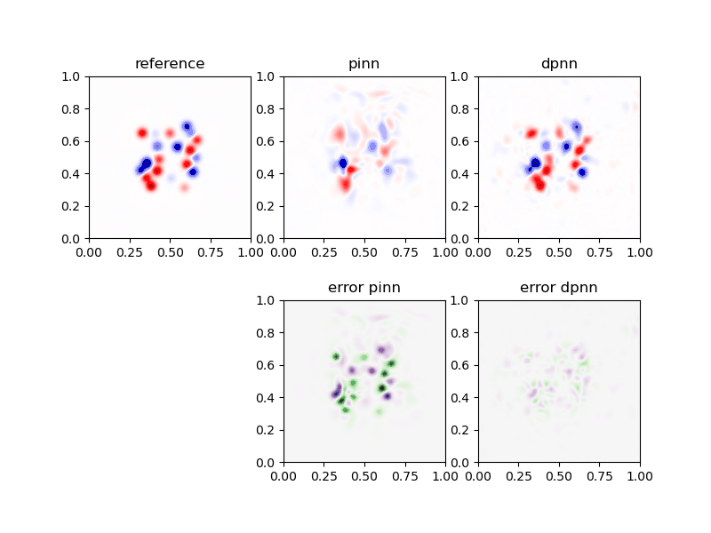

## Differentiable Physics for Sound Field Reconstruction

This repository allows you to solve sound field reconstruction problems using **differentiable-physics to train neural networks** (DPNN).

The DPNN approach is described in detail here:

S. A. Verburg, E. Fernandez-Grande, P. Gerstoft, "Differentiable physics for sound field reconstruction", J. Acoust. Soc. Am. 158, 5 (2025).

<p align="center">
    
</p>

This repository implements two deep-learning approaches for reconstructing acoustic fields from sparse sensor measurements:

- PINN — physics-informed neural network that models $p(x,y,t)$ (`src/diffsfr/pinn.py`).
- DPNN — physics-constrained neural network that models the initial pressure $p(x,y,0)$ and uses a differentiable FDTD solver to impose physics (`src/diffsfr/dpnn.py`).

### 📁 Repo layout

- `src/diffsfr/` — core implementation (the `diffsfr` package)
	- `pinn.py` — PINN implementation, training loop, save/load helpers
	- `dpnn.py` — DPNN implementation and training loop
	- `wave_solver.py` — explicit FDTD time-integrator and its discrete adjoint
	- `fields.py` — `SoundField` container and generation 
	- `sensors.py` — `SensorArray` sensor distributions and observed data 
	- `utils.py` — helpers
	- `plots.py` — plotting

- `examples/` — `example.ipynb` demonstrates the workflow: build/load field → sensor sampling → train PINN/DPNN → compare.
- `examples/data/` — pickled `SoundField` instances used by examples.
- `examples/models/` — example trained models and training histories (loss and lambda arrays).


### ⚙️ Installation

1. Clone the repository (SSH or HTTPS):

```bash
# SSH (if you have SSH keys configured)
git clone git@github.com:samuel-verburg/differentiable-soundfield-reconstruction.git

# OR HTTPS
git clone https://github.com/samuel-verburg/differentiable-soundfield-reconstruction.git

cd differentiable-soundfield-reconstruction
```
2. Create and activate an environment, either with venv

```bash
python -m venv .venv
source .venv/bin/activate      # Linux/macOS
.venv\Scripts\activate         # Windows
```

or with conda

```bash
conda create -n diffsfr python
conda activate diffsfr
```

3. (Optional) Install PyTorch first to choose the build. Visit https://pytorch.org/get-started/locally/ and use the selector to get the pip command for your platform and CUDA version. For example, CPU-only:
```bash
pip install torch --index-url https://download.pytorch.org/whl/cpu
```
If you skip this step, step 4 installs the default PyTorch build from PyPI.

4. Install the package in editable mode from the repository root, with the test dependencies
```bash
python -m pip install -e ".[dev]"
```
This installs all dependencies, makes `import diffsfr` work from any directory, and makes edits to `src/diffsfr/` take effect without reinstalling (restart the Python kernel to pick them up). Use the same environment for the notebook and the tests.

### 🚀 Quick start — run the example notebook

From the repository root, start Jupyter and open the example notebook:

```bash
jupyter notebook examples/example.ipynb
```
In the notebook, run cells in order. Notes:
- The notebook locates `examples/` through the installed package, so the working directory does not matter. Select the kernel of the environment where you ran `pip install -e .`.
- For quicker runs or debugging set `device='cpu'` in the notebook; the code defaults to GPU when available.

### 🔁 Gradients through the solver

`DPNN(..., gradient=...)` selects how the data-loss gradient is propagated through the FDTD solver (`src/diffsfr/wave_solver.py`):

| `gradient` | Method | Memory | Notes |
|---|---|---|---|
| `"adjoint"` (default) | hand-written discrete adjoint: the transposed solver runs backward in time, driven by the sensor residuals | three fields, independent of `n_T` | exact gradient of the discrete loss |
| `"operator"` | the linear map from `p0` to the sensor traces is precomputed once as a matrix `G` | `M_ob * n_T * n_L**2` | fastest per iteration for small 2D problems |
| `"autograd"` | PyTorch autodiff through every solver step (original implementation) | grows with `n_T * n_L**2` | reference |

All three give the same gradient up to floating-point rounding. Run the tests with `python -m pytest` from the repository root, using the same environment as the notebook.

### ⚠️ Important points

- Do not change `Grid` attribute names (`xx, yy, t, xy, xyt, n_L, n_T, dx, dy, dt`) — many functions rely on them.
- The DPNN initializer enforces a CFL-like stability check on `grid.dt`; if you hit the stability error, adjust `dt` or increase spatial resolution (smaller `dx`).
- Model saving: `PINN.save_nn(path)` and `DPNN.save_nn(path)` write a `.pt` file and two history files named `*_loss_hist.npy` and `*_lamb_hist.npy` — preserve these names if you change save/load logic.

### 👥 Maintainers

Author / maintainer: Samuel A. Verburg — saveri@dtu.dk


### 📜 License

See the `LICENSE` file in the repository root.

### 📚 Citation

If you find our code useful and use them in your own work, please use the following citation entry:

```
@article{Verburg2025,
author = {Verburg, S. A. and Fernandez-Grande, Efren and Gerstoft, Peter},
doi = {https://doi.org/10.1121/10.0039862},
journal = {J. Acoust. Soc. Am.},
number = {5},
pages = {4059--4069},
title = {Differentiable physics for sound field reconstruction},
volume = {158},
year = {2025}
}
```

---